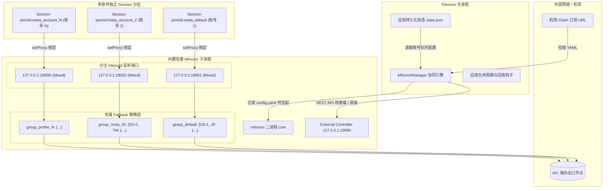
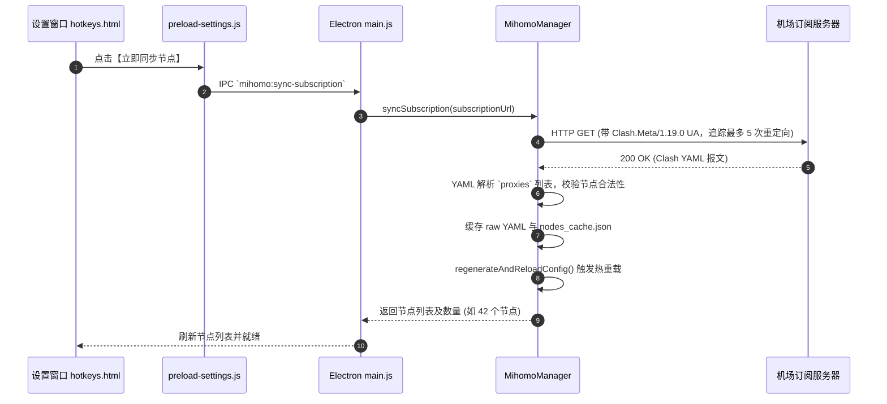

# 架构设计：内置 Mihomo 代理分流引擎与多账号独立出口队列

## 1. 架构背景与系统定位

### 1.1 业务背景与风控挑战
在 Muse Desktop 运行过程中，重度用户通常挂载多个 Muse AI 与 Meta AI 账号。由于各大海外 AI 平台（尤其是 Meta AI）对请求源 IP 与指纹有极高的风控敏感度，当多个账号共用同一本地系统代理、同一节点出口甚至同一 IP 段时，极易触发联防风控、验证码拦截（Cloudflare/CAPTCHA）乃至集体封号。

### 1.2 核心目标
1. **进程级内置协同**：将 Mihomo (Clash.Meta) 二进制作为子进程嵌入应用内部，不依赖宿主系统全局代理或外部客户端；
2. **机场订阅全自动解析**：直接填入机场 Clash 订阅链接，自动抓取、重定向追踪并解析出全部节点列表；
3. **账号级物理隔离出口**：为每一个账号 Profile 分配独立的本地 Inbound 端口与专属代理队列（Proxy Queue）；
4. **自动故障转移 (Fallback)**：账号配置多个节点作为队列，主节点故障时由内核毫秒级无缝漂移到备用节点，避免业务中断；
5. **Session 级无感知分流**：Electron Session Partition 精确绑定各账号专属本地端口，上层业务与前端页面完全透明。



---

## 2. 核心模块与职责划分

| 模块名称 | 对应源码路径 | 核心职责 |
| :--- | :--- | :--- |
| **MihomoManager** | `mihomo-manager.js` | 订阅拉取解析、动态配置 YAML 合成、子进程生命周期守护、REST Controller 通信与节点测速 |
| **Electron Main Proxy Router** | `main.js` | 主进程入口、Session Partition 分区代理策略下发（`applyProxyToSession`）、Mihomo IPC 通道注册与退出清理 |
| **Settings UI / Preload** | `hotkeys.html`<br>`preload-settings.js` | 渲染层配置界面：订阅 URL 设置、节点同步、全节点测速展示、代理状态总览 |
| **Account Hub / Modal** | `preload-chat-export.js` | 账号中心看板卡片出口展示（“🛡️ 代理出口”）、编辑账号弹窗专属节点队列多选与优先级排序器 |
| **Local Binary Bin** | `bin/mihomo/` | 内置二进制存放路径（Windows 下为 `mihomo-windows-amd64.exe`，Linux 为 `mihomo`，受 `.gitignore` 保护） |

---

## 3. 关键业务流程与时序图

### 3.1 机场订阅拉取与全量节点解析


### 3.2 账号分立端口动态分配与 Session 路由
```mermaid
sequenceDiagram
    autonumber
    participant App as 客户端启动/切换账号
    participant Main as main.js (applyProxyToSession)
    participant MM as MihomoManager
    participant Session as Electron Partition Session
    participant Core as 内置 Mihomo 进程

    App->>Main: 加载 Profile (例如 profileId = "account_173000")
    alt state.mihomo.enabled == true
        Main->>MM: getAccountPort(profileId)
        MM-->>Main: 返回专用端口 (例如 18002)
        Main->>Session: setProxy({ proxyRules: "http://127.0.0.1:18002;https://127.0.0.1:18002;socks5://127.0.0.1:18002", proxyBypassRules: "<local>;localhost;127.0.0.1" })
        Session->>Core: 账号发起的一切 Web/API 请求发送到 127.0.0.1:18002
        Core->>Core: Inbound 18002 命中 `group_account_173000` (Fallback 队列)
        Core-->>Session: 经由该账号专属第一优先节点出口
    else 使用默认代理或直连
        Main->>Session: setProxy(全局固定代理或直连)
    end
```

---

## 4. 关键设计细节与实现机制

### 4.1 端口拓扑与动态 YAML 规则生成
在 `mihomo-manager.js` 中，动态生成的 `userData/mihomo/config.yaml` 具备如下规范拓扑：
- **混合端口 (Global Mixed Port)**：`18000`
- **外部控制器 (REST Controller)**：`127.0.0.1:19090`，安全鉴权密钥设为 `muse-mihomo-internal`；
- **分立监听器 (Listeners)**：
  ```yaml
  listeners:
    - name: listener_default
      type: mixed
      port: 18001
      proxy: group_default
    - name: listener_account_2
      type: mixed
      port: 18002
      proxy: group_account_2
  ```
- **专属策略组 (Proxy Groups)**：
  为每个已配置代理队列的账号生成一个专属 `fallback` 组：
  ```yaml
  proxy-groups:
    - name: group_account_2
      type: fallback
      url: http://www.gstatic.com/generate_204
      interval: 300
      proxies:
        - "日本-OS-1-流量倍率:0.6"
        - "美国-US-3-流量倍率:1.0"
  ```
  当首选日本节点网络抖动或不可达时，Mihomo 自动在 300 秒探测期内故障转移至美国节点，保障网页对话不掉线。

### 4.2 优雅启停与孤儿进程防护
为避免应用异常崩溃或强退后 Mihomo 子进程成为后台僵尸进程并霸占端口：
1. **主进程全生命周期监听**：挂载 `process.on('exit')`、`process.on('SIGINT')`、`process.on('SIGTERM')` 及 Electron `app.on('before-quit')`；
2. **主动回收**：调用 `killProcess()`，先尝试发送 `SIGTERM`，超时 1.5 秒未退出则强杀 `SIGKILL`；
3. **启动前端口探针**：每次启动时使用 Node `net.createServer` 测试控制器端口（19090）和基础代理端口（18000）是否可用，若被残留旧进程占用则自动预清理。

---

## 5. 架构决策与权衡 (ADR 摘要)

### 5.1 为何选择内置 Mihomo 而非调用宿主系统代理？
* **备选方案 A**：让用户在本地运行 Clash Verge / v2rayN，并在 Muse 中配置系统全局代理。
  * *放弃原因*：全局代理会导致所有账号走同一个节点出口，无法做到账号间物理出口隔离，Meta AI 极易触发批量风控；且依赖用户自行配置，开箱体验差。
* **备选方案 B**：纯 JS 实现 Socks5 代理中转与加密协议。
  * *放弃原因*：Shadowsocks/Trojan/Vmess/Hysteria2 协议繁杂、加解密计算量大，纯 Node 性能低下且维护成本极高。
* **最终方案**：内置官方跨平台轻量 Mihomo (Clash.Meta) 二进制。成熟稳定、开箱即用，通过动态配置 + Electron Session 端口映射，实现架构清晰、零系统侵入的账号级独立出口分流。

### 5.2 已知边界与约束
1. **二进制分发包体积**：Mihomo 单二进制大小约为 40MB～50MB，生产打包时可选择直接打包进安装包，或首次启动时自动下载；
2. **端口范围预留**：基础端口占用范围为 `18000 ~ 18099`（最多支持 100 个并发账号），请确保该端口段不与本机其他特定开发服务冲突。
