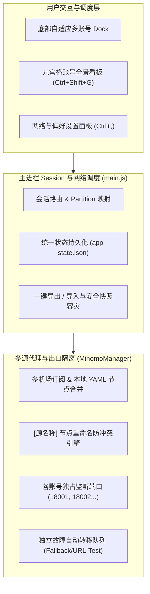
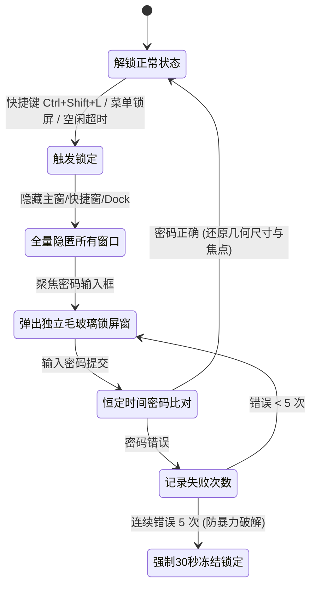

# Muse Desktop 官方用户使用与配置全景手册 (User Manual)

> **适用版本**：v1.5.24+  
> **适用平台**：Windows 10/11、Linux (Ubuntu 20.04/22.04/24.04+、Debian、Arch)、macOS (Intel / Apple Silicon)  
> **文档维护**：Muse 核心研发团队

---

## 目录
1. [项目简介与核心架构](#1-项目简介与核心架构)
2. [下载与跨平台安装指南](#2-下载与跨平台安装指南)
3. [多账号隔离与九宫格管理中心 (Account Hub)](#3-多账号隔离与九宫格管理中心-account-hub)
4. [内置 Mihomo 智能分流与多源节点池](#4-内置-mihomo-智能分流与多源节点池)
5. [账号级专属代理出口与批量节点配置](#5-账号级专属代理出口与批量节点配置)
6. [配置备份、导出与跨设备/跨系统热迁移](#6-配置备份导出与跨设备跨系统热迁移)
7. [主密码安全锁屏与隐私守护](#7-主密码安全锁屏与隐私守护)
8. [自动化审批控制 (Auto-Allow) 与会话导出](#8-自动化审批控制-auto-allow-与会话导出)
9. [全局快捷键速查表](#9-全局快捷键速查表)
10. [常见问题排查与技术自愈 (FAQ)](#10-常见问题排查与技术自愈-faq)

---

## 1. 项目简介与核心架构

**Muse Desktop** 是一款面向专业开发者、研究人员及多会话运营人员的高性能桌面客户端，将 Muse ([muse.ai](https://muse.ai)) 与 Meta AI ([meta.ai](https://www.meta.ai)) 深度封装于轻量原生容器中。



### 核心亮点：
* 👥 **真正的物理级多账号隔离**：采用 Chromium 原生 `persist:partition` 机制，每个账号独立的 Cookie、LocalStorage、Token 与缓存，支持 17+ 乃至无限账号并发；
* 🛡️ **内置轻量 Mihomo 代理分流引擎**：支持多个机场订阅与本地 YAML 配置文件同时开启、并发合并；每个账号可分配专属独立的出口 IP 队列与故障转移策略，彻底避免多账号因共用同一出口 IP 导致连带风控；
* 🌐 **多模式自由切换**：支持每个账号单独设置代理模式（跟随全局、强制走系统代理/TUN 虚拟网卡、内置专属出口队列、直接连接、独立自定义代理）；
* 📦 **跨电脑 / 跨系统一键迁移**：支持将 17+ 账号的所有配置、分组、代理队列与订阅源一键导出为标准 JSON 备份，并在 Windows 与 Linux (Ubuntu) 之间秒级还原；
* 🔒 **密码学级主密码锁屏**：基于加盐慢哈希（`scryptSync`）与恒定时间校验，支持空闲自动锁定，全量遮蔽聊天界面。

---

## 2. 下载与跨平台安装指南

项目所有版本产物均可在 GitHub Releases 页面直接下载：

### 2.1 Windows 平台
* **安装版 (`Muse Setup x.x.x.exe`)**：
  * 基于 NSIS 打包，双击运行即可自动安装并创建桌面与开始菜单快捷方式，支持自动版本更新。
* **便携绿色单文件版 (`Muse x.x.x.exe`)**：
  * 无需安装，即点即用；配置文件默认统一定位在系统的 `%APPDATA%\Muse` 目录下，与安装版完全无缝互通。

### 2.2 Linux / Ubuntu 平台
* **Debian / Ubuntu 原生包 (`.deb`)【强烈推荐】**：
  ```bash
  sudo dpkg -i muse_*.deb
  # 若提示依赖问题，执行：
  sudo apt-get install -f
  ```
  * **系统集成特性**：自带安装后钩子脚本（`scripts/linux-after-install.sh`），自动建立 `/usr/bin/muse` 全局软链接、刷新 GTK 桌面图标缓存、并将 `StartupWMClass` 绑定为 `Muse`，彻底杜绝 GNOME 任务栏/Dock 图标变成齿轮的问题；
  * **Ubuntu 24.04+ AppArmor 专项适配**：自动注入 `/etc/apparmor.d/muse` 安全配置，解决 Ubuntu 24.04 限制非特权命名空间导致 Chromium 白屏的问题。
* **通用便携包 (`.AppImage`)**：
  ```bash
  chmod +x muse_*.AppImage
  ./muse_*.AppImage
  ```
* **绿色归档包 (`.tar.gz`)**：
  * 解压后直接进入目录运行 `./muse` 即可。

### 2.3 macOS 平台
* 下载 `.dmg` 镜像，将 Muse 图标拖入 `Applications` 目录即可；支持 Apple Silicon (M1/M2/M3/M4) 与 Intel 架构（Universal 二进制）。

---

## 3. 多账号隔离与九宫格管理中心 (Account Hub)

Muse Desktop 彻底解决了传统浏览器中频繁登出、切换无痕窗口或配置多个浏览器 Profile 的痛苦。

### 3.1 底部自适应多账号 Dock 栏
* **位置与显示**：屏幕底部居中悬浮展示当前配置的所有账号头像圆标；
* **固定与自动隐藏**：
  * 点击 Dock 左上角的 **📌 钉子按钮** 可锁定常驻展开；
  * 默认状态下移开鼠标会自动收起为 14px 纤细边缘指示条，鼠标悬停时毫秒级平滑展开；
* **无限账号横向滚动**：针对 17+ 大量账号场景，Dock 栏支持滚轮直接横向平滑滚动；
* **右键快捷菜单**：
  * 右键点击任意账号头像：可执行「编辑详情」、「修改备注」、「重新排列」或「退出登录」。

### 3.2 九宫格全景账号管理看板 (Account Hub)
按下全局快捷键 **`Ctrl + Shift + G`**（macOS 为 **`Cmd + Shift + G`**）或点击 Dock 栏最左侧的 **⊞ 图标** 即可调出看板：

```text
+-----------------------------------------------------------------------------------+
| ⊞ 多账号管理中心 · 九宫格看板  [17 账号 · 3 群组]    [搜索账号昵称、用途或群组...]  |
|                                                                                   |
| [📤 导出配置]  [📥 导入配置]  [📁 本地数据]  [🔄 飞书同步]  [⚙ 飞书配置]  [➕ 添加账号]  |
+-----------------------------------------------------------------------------------+
| [默认群组 (8)]  [爬虫自动化组 (5)]  [自用日常组 (4)]                                 |
+-----------------------------------------------------------------------------------+
| +-------------------------+ +-------------------------+ +-----------------------+ |
| | 👤 云逸  [正在使用]     | | 👤 云澈                 | | 👤 竞品调研01         | |
| | 群组: 爬虫自动化组      | | 群组: 默认群组          | | 群组: 自动化组        | |
| | 用途: 生产环境调度测试  | | 用途: 核心工作会话      | | 用途: 每日数据比对    | |
| | 🌐 强制系统代理/TUN    | | 🛡️ us美国01 (+3备用)    | | 🌐 直接连接 (Direct)  | |
| | 用量: [||||||....] 45%  | | 用量: [||........] 15%  | | 用量: [||||||||] 80%  | |
| | [切换至此账号] [📝编辑] | | [切换至此账号] [📝编辑] | | [切换至此账号] [📝编辑] |
| +-------------------------+ +-------------------------+ +-----------------------+ |
+-----------------------------------------------------------------------------------+
```

#### 看板核心功能：
1. **即时全局搜索**：输入关键字即时过滤账号昵称、主要用途或群组；
2. **群组分类管理**：支持自定义创建业务群组（如“自用”、“数据采集”、“技术调研”等），并按群组快速归类查看；
3. **元数据详情维护**：为每个账号定义个性化用途说明、设定用量占比报警阈值、记录 Token 刷新时间；
4. **飞书多维表格双向同步**：点击【飞书配置】填入飞书开放平台 App ID、Secret 及 Base Token，即可一键将云端表格与本地账号状态双向对齐同步。

---

## 4. 内置 Mihomo 智能分流与多源节点池

传统的全局代理客户端（如 Clash Verge、v2rayN）会让桌面上所有账号走同一个节点出口，极易因同一 IP 并发调用触发平台的账号关联防刷风控。Muse Desktop 内置了轻量级 **Mihomo (Clash.Meta)** 核心，由主进程直接托管生命周期。

### 4.1 开启内置 Mihomo 智能分流
1. 按快捷键 **`Ctrl + ,`** 打开【设置与快捷键】面板；
2. 切换到 **【网络与代理】** 选项卡；
3. 在连接模式中选择 **【内置 Mihomo 智能分流（机场订阅与多账号独立队列）】**。

### 4.2 准备 Mihomo 内核文件
客户端支持多路径自动发现，只要满足以下任意一条即可识别：
* **Windows**：
  * 应用目录下的 `bin/mihomo/mihomo-windows-amd64-v3.exe` 或 `mihomo.exe`；
  * 数据目录 `%APPDATA%\Muse\mihomo\mihomo.exe`；
  * 系统 `PATH` 环境变量中包含的 `mihomo`。
* **Linux (Ubuntu)**：
  * `/usr/bin/mihomo` 或 `/usr/local/bin/mihomo`（`sudo apt install mihomo` 或手动放置）；
  * `~/.config/Muse/mihomo/mihomo`；
  * Clash Verge 系统路径 `/usr/bin/verge-mihomo`。
* **macOS**：
  * `/usr/local/bin/mihomo` 或 `~/Library/Application Support/Muse/mihomo/mihomo`。

### 4.3 多源配置：同时支持多个机场订阅与本地 YAML
Muse 允许多个订阅源同时开启并合并为一个综合节点池：

```text
[代理配置源 (多订阅 / 本地 YAML)]
已启用 2/2 个源 · 合并有效节点 68 个
[+ 添加订阅]      [📂 导入本地 YAML]      [🔄 全部同步]

☑️ [远程订阅]  默认机场A (45 节点)   https://airport-a.com/sub?token=...   [同步] [✕]
☑️ [本地 YAML]  自备备用节点 (23 节点) C:\Users\User\nodes.yaml             [同步] [✕]
```

1. **添加多个远程机场订阅**：点击 **`+ 添加订阅`**，输入源名称与订阅 URL，点击保存；
2. **导入本地 Clash YAML 节点**：点击 **`📂 导入本地 YAML`**，从本地磁盘直接选中已有的 `.yaml` 或 `.yml` 节点文件，免去搭建 Web 服务的繁琐；
3. **节点智能防冲突重命名引擎**：
   * 若机场 A 含有“`美国01`”，本地 YAML 也含有“`美国01`”，系统会自动规整为：
     * `[默认机场A] 美国01`
     * `[自备备用节点] 美国01`
   * 彻底杜绝 Mihomo 内核因节点同名导致启动崩溃或覆盖丢失问题；
4. **一键全节点延迟测速**：点击 **【一键全节点测速】**，客户端将对所有源的合并节点并发探测延迟，并以绿/黄/红毫秒标签清晰呈现。

---

## 5. 账号级专属代理出口与批量节点配置

在设置好节点池后，即可为各个账号随心指定其出口网络策略。

### 5.1 自由选择账号的代理模式
在九宫格看板中点击任意账号的 **【编辑详情】**（或在 Dock 头像右键点击“编辑详情”）：

| 代理模式 | 适用场景 | 行为表现 |
|---|---|---|
| **跟随全局 (`inherit`)** | 普通账号 | 跟随设置面板选定的全局连接模式。 |
| **自适应系统网络与 TUN 虚拟网卡 (`system`)** | **推荐：自用主力账号** | 强制直接走本机的系统代理或 Clash Verge / Sing-box 的 TUN 虚拟网卡；**即便全局开启了内置 Mihomo，该账号也强制走 TUN 直通**。 |
| **内置 Mihomo 专属出口队列 (`mihomo`)** | **推荐：业务/测试/隔离账号** | 分配独立的本地代理端口（如 `18001`、`18002`），并绑定该账号专属的出口节点故障转移队列。 |
| **直接连接 (`direct`)** | 国内直连站点/内网测试 | 绕过任何系统代理或 VPN，直接向目标发起网络请求。 |
| **手动代理覆盖 (`custom`)** | 搭配外部指定局域网网关 | 允许为该账号单独指定专用的 HTTP / SOCKS5 代理地址与端口（如 `127.0.0.1:7890`）。 |

### 5.2 批量添加节点与 1-Click 快捷导入
当账号开启专属出口队列（Mihomo 模式）时，无需逐个翻找下拉框添加：

```text
[专属代理出口队列 (Mihomo 故障转移)]
1. [默认机场] us美国01  [✕]
2. [默认机场] us美国02  [✕]
3. [本地YAML] us美国03  [✕]
...
[-- 批量选择节点或一键添加 --]
[ ＋ 批量选择节点... ]  [ + 全部节点 ]  [ + 全部美国 ]  [ + 全部香港 ]  [ + 全部日本 ]  [ + 全部新加坡 ]  [ 清空队列 ]
```

1. **1-Click 地区快捷添加**：
   * 点击 **`+ 全部美国`**：系统自动筛选所有订阅源中名称包含“美国/US/United States”的节点，一次性全部去重注入该账号队列；
   * 同理支持 **`+ 全部香港`**、**`+ 全部日本`**、**`+ 全部新加坡`** 与 **`+ 全部节点`**；
2. **高级批量选择弹窗 (`openBatchNodeSelectModal`)**：
   * 点击 **`＋ 批量选择节点...`** 打开全量选择模态框；
   * 提供实时搜索输入框、状态过滤（全部/未加入当前队列/各地区标签）；
   * 支持多选勾选、一键【全选】、【反选】；
   * 点击【确认批量添加】，所选节点立刻安全合并入队列，自动过滤重复项。
3. **故障自动转移 (Fallback)**：
   * 排在第一位的为 **主用节点 (👑)**；
   * 当主用节点遭遇网络抖动或超时时，Mihomo 内核会在毫秒级将该账号流量自动平滑转移至备用节点，会话完全不中断。

---

## 6. 配置备份、导出与跨设备/跨系统热迁移

当电脑上已经配置了 17+ 个账号及其复杂的代理队列、订阅源时，换机迁移非常繁琐。Muse 提供两套完整解决方案：

### 方案 A：软件内一键导出 / 导入配置（最轻量推荐）
* **导出操作**：
  1. 打开九宫格看板（`Ctrl+Shift+G`）或进入【设置】->【网络与代理】；
  2. 点击 **【📤 导出配置】**（或设置中的【📤 导出所有配置 (.json)】）；
  3. 选择保存路径，即可导出一个标准 JSON 备份文件（如 `muse-backup-2026-11-14.json`）；
  4. 备份文件已自动排除锁屏密码等敏感字段，安全可信。
* **导入恢复**：
  1. 在新电脑（无论是 Windows 还是 Ubuntu/Linux）上安装好 Muse；
  2. 点击 **【📥 导入配置】**；
  3. 选择备份的 `.json` 文件（**同时支持直接选择旧电脑上的 `app-state.json` 原始文件**）；
  4. 系统将自动：
     * 为当前环境做一份时间戳快照防灾备份（`app-state.pre-import-*.bak`）；
     * 智能恢复 17 个账号信息、群组分类、Mihomo 多订阅源及每个账号的代理队列；
     * 自动触发节点池重新合并与内核热载，所有账号配置即刻完整复原！

### 方案 B：全量热克隆免密迁移（连同 17 个账号登录态一同带走，免重新扫码登录）
如果希望连同所有账号的 **登录 Session、Cookie 与历史登录态** 一起搬到新环境，实现开箱免登录：

| 操作系统 | 数据目录存储路径 | 包含的关键数据 |
|---|---|---|
| **Windows** | `%APPDATA%\Muse\`<br>（即 `C:\Users\<用户名>\AppData\Roaming\Muse\`） | `app-state.json` (配置)<br>`Partitions/` (所有账号隔离的 Cookies/Session)<br>`mihomo/` (内核与运行时缓存) |
| **Linux (Ubuntu)** | `~/.config/Muse/` | 同上 |
| **macOS** | `~/Library/Application Support/Muse/` | 同上 |

#### 迁移步骤：
1. 退出原电脑上的 Muse 客户端（确保进程退出）；
2. 复制整个 `Muse` 文件夹到移动硬盘或内网传输；
3. 将该文件夹完整粘贴覆盖至新电脑的对应数据目录下；
4. 在新电脑启动 Muse，**不仅所有账号配置与代理完整复原，而且所有账号均保持已登录在线状态！**

---

## 7. 主密码安全锁屏与隐私守护

当工作机处于公共办公区、多人共享设备或需要离开工位时，一键启动主密码屏幕锁。



1. **设置主密码**：进入【设置】->【安全与锁屏】，设置保护密码；
2. **即时锁定**：按下全局快捷键 **`Ctrl + Shift + L`**（macOS 为 **`Cmd + Shift + L`**），或右键托盘选择锁定；
3. **空闲自动锁定**：勾选“开启无操作定时自动锁屏”，可设置 1 / 5 / 15 / 30 / 60 分钟自动超时锁定；
4. **防暴力破解**：连续输错 5 次密码自动触发 30 秒倒计时防爆破冷却锁。

---

## 8. 自动化审批控制 (Auto-Allow) 与会话导出

### 8.1 自动化审批 (Auto-Allow)
针对长链条 AI 自动化任务，用户可在【设置】->【自动化规则】中自主授权特定高频动作：
* **外部导航 (Links)**：自动放行跳转链接；
* **第三方集成 (Connectors)**：自动批准应用与插件授权；
* **文件访问 (File Access)**：自动批准文件上传与下载；
* **代码执行 (Code Execution)**：自动放行代码与脚本运行。

### 8.2 对话记录一键多格式导出
在任何会话界面中，按下 **`Ctrl + Shift + E`**（或点击托盘“导出当前会话记录”）：
* 支持将当前完整对话流导出为规范的 **Markdown (`.md`)**、富文本 **HTML (`.html`)** 或结构化 **JSON (`.json`)**；
* 自动保持代码块语法高亮，便于存档、分享与知识沉淀。

---

## 9. 全局快捷键速查表

用户可在【设置与快捷键】面板中任意自定义这些按键组合：

| 默认快捷键 (Win/Linux) | 默认快捷键 (macOS) | 功能说明 |
|---|---|---|
| **`Ctrl + Shift + G`** | **`Cmd + Shift + G`** | **打开九宫格账号全景管理看板 (Account Hub)** |
| **`Ctrl + Shift + Space`** | **`Cmd + Shift + Space`** | 呼出 / 隐藏极速快捷会话浮窗 (Quick Chat) |
| **`Ctrl + Shift + M`** | **`Cmd + Shift + M`** | 瞬间切换 Muse / Meta AI 站点 |
| **`Ctrl + Shift + N`** | **`Cmd + Shift + N`** | 切换至列表中的下一个账号 |
| **`Ctrl + Shift + L`** | **`Cmd + Shift + L`** | **立即锁定屏幕（激活毛玻璃密码锁屏）** |
| **`Ctrl + Shift + E`** | **`Cmd + Shift + E`** | 导出当前对话记录为文件 |
| **`Ctrl + Shift + U`** | **`Cmd + Shift + U`** | 麦克风静音 / 取消静音 |
| **`Ctrl + Shift + O`** | **`Cmd + Shift + O`** | 客户端扬声器静音 / 取消静音 |
| **`Ctrl + ,`** | **`Cmd + ,`** | 打开偏好设置面板 |
| **`F5`** / **`Ctrl + R`** | **`Cmd + R`** | 刷新当前账号视图 |

---

## 10. 常见问题排查与技术自愈 (FAQ)

### Q1: 在聊天消息中点击链接，有时打不开或误弹出浏览器？
* **解答**：最新版本已经过严密收口与根因修复。系统仅在用户鼠标**确切命中超链接文本**（`<a href="http...">`）时才会调起默认浏览器访问；点击消息气泡空白处、普通文本、复制文本或代码块时绝不会误唤起浏览器。空锚点（`href="#"`）会自动屏蔽。

### Q2: 在 Ubuntu 24.04 上启动客户端，提示沙箱权限错误或白屏？
* **解答**：Ubuntu 24.04 默认限制了非特权用户命名空间（`unprivileged user namespaces`）。
  * 建议使用 `.deb` 安装包安装，其自带的 post-install 脚本会自动配置好 AppArmor 与 SUID 权限；
  * 若直接解压运行，可在终端带 `--no-sandbox` 参数启动：
    ```bash
    ./muse --no-sandbox
    ```

### Q3: 开启内置 Mihomo 后，提示“内核文件未找到”？
* **解答**：
  1. **Windows 用户**：确保已将 `mihomo-windows-amd64-v3.exe`（或重命名为 `mihomo.exe`）放置在应用目录下的 `bin/mihomo/` 文件夹中；
  2. **Ubuntu 用户**：直接在系统执行 `sudo apt install mihomo`，或下载 Linux 版本的 Mihomo 二进制放入 `/usr/local/bin/mihomo` 并执行 `chmod +x /usr/local/bin/mihomo`；客户端会自动通过系统 PATH 识别并运行。

### Q4: 提示 Google 账号登录被风控拦截（RFC 8252）？
* **解答**：
  * Google 官方规范禁止在任何内嵌 Webview 中直接输入账号密码；
  * **正规解决方案**：在系统默认外部浏览器中登录 muse.ai 绑定好 Google 账号后，返回桌面客户端按 **F5** 刷新即可自动完成授权；
  * 若曾被标记风控，可进入设置面板【网络与代理】底部点击 **【🧹 重置 Google 登录与风控缓存】**。

---

*本文档随 Muse Desktop 持续维护迭代。如遇问题欢迎提交 Issue 或联络项目维护者。*
